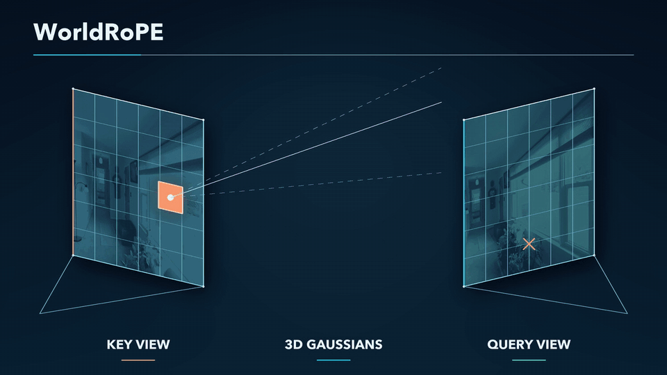

<h2 align="center">WorldRoPE: Probabilistic World-Centric Rotary Embedding<br>for Multi-View Attention</h2>

<p align="center">
  <a href="https://mjmjeong.github.io/">Mijeong Kim</a><sup>1</sup> · Kyujin Lim<sup>2</sup> · Bohyung Han<sup>1,2</sup><br>
  <sup>1</sup> ECE · <sup>2</sup> IPAI, Seoul National University
</p>

<p align="center">
  <a href="https://arxiv.org/abs/2610.16337"></a>
  <a href="https://mjmjeong.github.io/research_projects/worldrope/"></a>
  <a href="https://huggingface.co/mijeongkim/WorldRoPE"></a>
  <a href="#using-worldrope"></a>
</p>

<h3 align="center">Multi-view attention, grounded in 3D.</h3>

<p align="center">
  
</p>

**WorldRoPE** represents each image token with probabilistic 3D Gaussian supports
and integrates rotary embeddings over their projection into a query view.
It captures multiple depth hypotheses, depth uncertainty and the spatial extent
of a patch, without rasterizing or warping token features.


## Updates

- **[2026-11-02]** Updated **WorldRoPE(ours)** usage instructions, including the [Plücker ray](https://github.com/haian-jin/LVSM), [PRoPE (NeurIPS 2025)](https://github.com/liruilong940607/prope), [RayRoPE (ECCV 2026)](https://github.com/Lucas-707/RayRoPE) and [URoPE (ECCV 2026)](https://urope-pe.github.io/) baselines.
- **[2026-11-02]** Reorganized the implementation and added a standalone usage example.

## Using WorldRoPE

WorldRoPE predicts Gaussian supports from the token features at each layer.
The attention module and its matching MHA can be initialized as follows:

```python
from pos_enc.worldrope import WorldRoPEDotProductAttention

worldrope = WorldRoPEDotProductAttention(
    head_num=16, head_dim=48,
    patches_x=32, patches_y=32,
    image_width=256, image_height=256,
)
mha = worldrope.make_mha(embed_dim=768)

def sdpa(q, k, v, **kwargs):
    return worldrope(q, k, v, viewmats=viewmats, Ks=Ks, **kwargs)

output = mha(tokens, tokens, tokens, sdpa_fn=sdpa)
```

`tokens` has shape `[B, V×patches, C]`, `viewmats` is `[B,V,4,4]`, and `Ks` is
`[B,V,3,3]`. Tokens are grouped by view. Use pixel-valued intrinsics and the
Blender/OpenGL world-to-camera convention expected by the NVS loader.

For a complete example with synthetic cameras and backward:

```bash
python scripts/example_usage.py
```

### Implementation

```text
pos_enc/
├── worldrope/
│   ├── attention.py
│   ├── token_with_gaussian_splatting.py
│   └── integration_probabilistic_rope.py
├── rayrope/
│   ├── attention.py
│   ├── token_to_ray.py
│   └── mha.py
├── urope/
│   ├── attention.py
│   └── multi_head_anchor.py
├── plucker_ray/
├── prope/
├── xy_rope/
└── utils/                     # Shared attention, Transformer and camera utilities
```

Gaussian support construction and projection live in
`token_with_gaussian_splatting.py`; expected rotary coefficients live in
`integration_probabilistic_rope.py`. Here “splatting” refers to finite Gaussian
support: the implementation does not rasterize token features.

Each method package exposes its public API through `__init__.py`. Baseline
variants remain in their method folders. RE10K and Objaverse use this same
implementation, with dataset-specific camera and depth settings.

## NVS experiments

### Environment setup

```bash
conda create -n worldrope python=3.11
conda activate worldrope
pip install -r requirements.txt
```

We use PyTorch 2.5.1 and CUDA 12.4 wheels. Training and evaluation require CUDA;
the standalone example also runs on CPU.

### Dataset setup

**RealEstate10K.** Prepare a scene/view tree with `train/<scene>/transforms.json`,
`train/<scene>/images/`, and corresponding `test/` directories. The camera
conversion and image preprocessing utilities are in `scripts/`.

**Objaverse.** Prepare packed radial-0 renders with a matching training schedule.
Select this backend with `--dataset objaverse`; both datasets use the same code.

See [data preparation and camera conventions](docs/DATA.md) for the exact formats,
preprocessing commands and optional cache builders. Datasets and sampling caches
are not included in the repository.

### Training

Training and evaluation are launched with `scripts/nvs.sh`:

```bash
bash scripts/nvs.sh --dataset re10k --method worldrope --gpus 0,1 \
  --data-root /path/to/re10k \
  --output-dir /path/to/new-training-output
```

Use `--method rayrope` or `--method urope` for the corresponding baseline.
Other supported options are `plucker`, `prope` and `xyrope`.
Run `bash scripts/nvs.sh --help` for arguments, or add `--dry-run` to inspect
the resolved configuration without starting training.

For Objaverse, supply the packed data and its two-rank training schedule:

```bash
bash scripts/nvs.sh --dataset objaverse --method worldrope --gpus 0,1 \
  --fast-dir /path/to/objaverse-packed --schedule /path/to/schedule.npy \
  --output-dir /path/to/new-training-output
```

The main WorldRoPE model has six Transformer layers and **24.5M parameters**.
Training uses MSE and the inherited VGG perceptual loss; its VGG weights must be
prepared separately. See [data preparation](docs/DATA.md) for fixed-schedule
training and the data needed to match the original experiments.

### Evaluation

```bash
bash scripts/nvs.sh --dataset re10k --method worldrope --gpus 0 \
  --data-root /path/to/re10k --test \
  --checkpoint /path/to/checkpoint.pt \
  --output-dir /path/to/new-evaluation-output
```

Evaluation reports PSNR, SSIM and AlexNet LPIPS. The RE10K protocol uses two
context views and three target views. LPIPS requires its pretrained AlexNet
weights. Evaluate Objaverse through the same entry point:

```bash
bash scripts/nvs.sh --dataset objaverse --method worldrope --gpus 0 \
  --fast-dir /path/to/objaverse-packed --test \
  --checkpoint /path/to/worldrope_lvsm/objaverse/model.pt \
  --output-dir /path/to/new-evaluation-output
```

The included Objaverse evaluator uses **gap 4**. The paper reports a mixed-gap
protocol whose external evaluation wrapper is not included; these protocols
should be compared separately.

### Checkpoints

WorldRoPE, RayRoPE and URoPE checkpoints and the model card are available on
[Hugging Face](https://huggingface.co/mijeongkim/WorldRoPE).

| Method | Checkpoint family |
|:--|:--|
| [RayRoPE (ECCV 2026, spotlight)](https://github.com/Lucas-707/RayRoPE) | [`rayrope_lvsm_reproduce`](https://huggingface.co/mijeongkim/WorldRoPE/tree/main/rayrope_lvsm_reproduce) |
| [URoPE (ECCV 2026, spotlight)](https://urope-pe.github.io/) | [`urope_lvsm_reproduce`](https://huggingface.co/mijeongkim/WorldRoPE/tree/main/urope_lvsm_reproduce) |
| **WorldRoPE** | **[`worldrope_lvsm`](https://huggingface.co/mijeongkim/WorldRoPE/tree/main/worldrope_lvsm)** |

Download [RE10K weights](https://huggingface.co/mijeongkim/WorldRoPE/resolve/main/worldrope_lvsm/re10k/model.pt)
or [Objaverse weights](https://huggingface.co/mijeongkim/WorldRoPE/resolve/main/worldrope_lvsm/objaverse/model.pt),
or fetch all checkpoints with their configurations:

```bash
hf download mijeongkim/WorldRoPE --local-dir checkpoints
```

Existing main WorldRoPE weights retain their tensor keys after the code
reorganization. To verify a checkpoint and its saved configuration:

```bash
python scripts/check_checkpoint.py \
  --checkpoint /path/to/checkpoint.pt --config /path/to/config.yaml
```

Legacy configurations can be converted with `scripts/convert_config.py`.
See [checkpoint configurations](docs/CHECKPOINTS.md) for saved architectures
and baseline loading instructions. Use `--model-config` for a checkpoint whose
architecture differs from the default integration recipe.

## Results

Reported novel view synthesis results from the paper:

| Method | RE10K PSNR ↑ | SSIM ↑ | LPIPS ↓ | Objaverse PSNR ↑ | SSIM ↑ | LPIPS ↓ |
|:--|--:|--:|--:|--:|--:|--:|
| RayRoPE | 26.17 | 0.833 | 0.081 | 22.25 | 0.892 | 0.121 |
| URoPE | 26.26 | 0.834 | 0.078 | 21.99 | 0.890 | 0.128 |
| **WorldRoPE** | **26.75** | **0.846** | **0.073** | **22.52** | **0.896** | **0.113** |

The reorganized WorldRoPE implementation was checked against its original
source: outputs and gradients match on synthetic inputs, and real-image FP16
inference on four scenes per dataset produces identical images and metrics.
This is an implementation check, not a new full benchmark.

## Citation

```bibtex
@article{kim2026worldrope,
  title={WorldRoPE: Probabilistic World-Centric Rotary Embedding for Multi-View Attention},
  author={Kim, Mijeong and Lim, Kyujin and Han, Bohyung},
  journal={arXiv preprint arXiv:2610.16337},
  year={2026}
}
```

## Acknowledgements

Our implementation builds on [RayRoPE](https://github.com/Lucas-707/RayRoPE),
[URoPE](https://urope-pe.github.io/),
[PRoPE](https://github.com/liruilong940607/prope) and
[LVSM](https://github.com/haian-jin/LVSM). We thank the authors for sharing their work.

See [LICENSE](LICENSE), [NOTICE](licenses/NOTICE) and
[THIRD_PARTY_LICENSES](licenses/THIRD_PARTY_LICENSES)
for the inherited terms, attributions and the unresolved perceptual-loss license
item.
