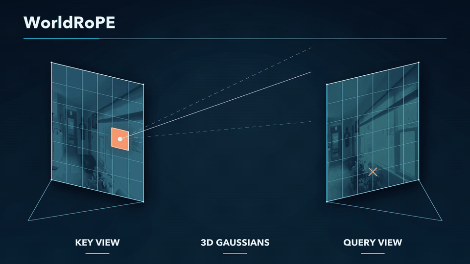
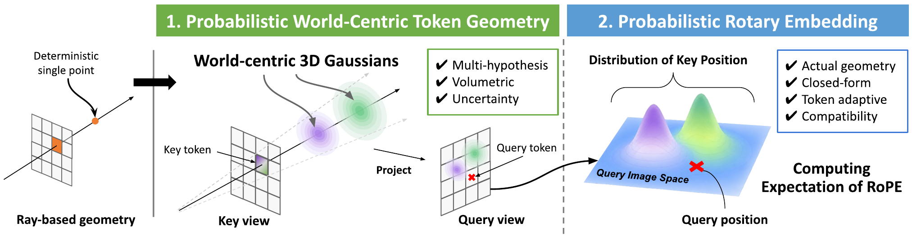
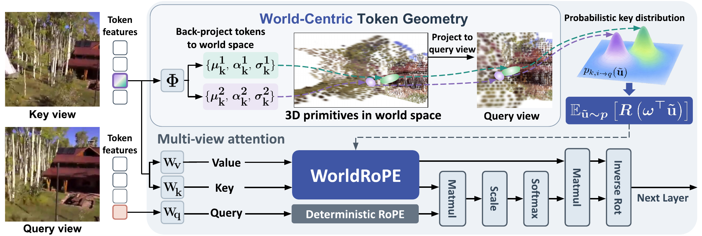
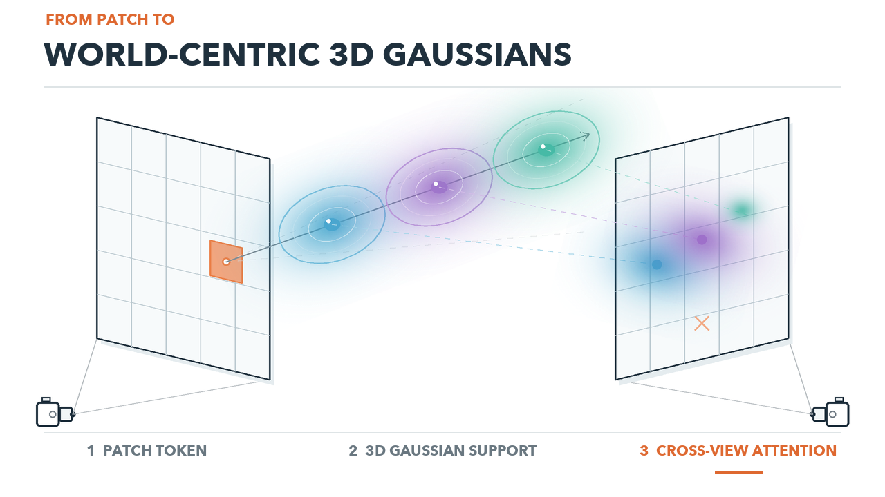
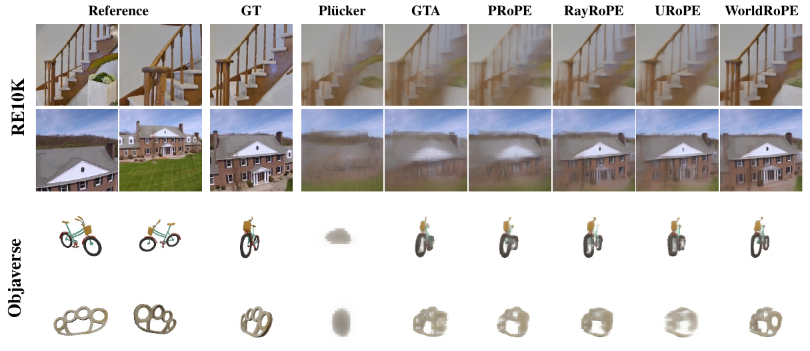
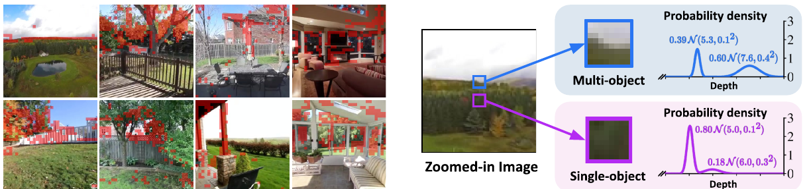
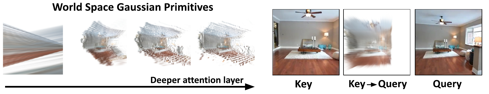

# WorldRoPE: Probabilistic World-Centric Rotary Embedding for Multi-View Attention

<p align="center">
  
</p>

<p align="center">
  <a href="https://mjmjeong.github.io/research_projects/worldrope/">Project Page</a> ·
  <a href="https://arxiv.org/abs/2610.16337">Paper</a> ·
  <a href="https://github.com/mjmjeong/WorldRoPE">Code (coming soon)</a>
</p>

<p align="center">
  <b>Multi-view attention, grounded in 3D.</b>
</p>

<p align="center">
  <a href="https://arxiv.org/abs/2610.16337"></a>
  <a href="https://mjmjeong.github.io/research_projects/worldrope/"></a>
  <a href="https://github.com/mjmjeong/WorldRoPE"></a>
</p>

Mijeong Kim<sup>1</sup> · Kyujin Lim<sup>2</sup> · Bohyung Han<sup>1,2</sup>

<sup>1</sup> ECE · <sup>2</sup> IPAI, Seoul National University

> **Status:** The research code is being prepared and will be released soon. Check back shortly for installation instructions, pretrained models, and reproducible evaluation scripts.

## News

- **2026-10-22:** Project page and paper released. Code and pretrained models are coming soon.

## ✨ Highlights

<table>
  <tr>
    <td width="33%" valign="top"><b>🌍 World-centric geometry</b><br>Represent each patch as a probabilistic set of 3D Gaussian supports in a shared world frame.</td>
    <td width="33%" valign="top"><b>🎯 Geometry-aware attention</b><br>Project uncertain key supports into the query view to establish cross-view correspondence.</td>
    <td width="33%" valign="top"><b>⚡ Closed-form RoPE</b><br>Integrate the rotary operator analytically without rasterizing or warping token features.</td>
  </tr>
</table>

## Overview

Rotary Positional Embedding (RoPE) encodes relative positions in Transformers. In multi-view settings, however, image coordinates are defined independently in each camera view: the same 3D point can therefore receive different 2D coordinates across views.

**WorldRoPE** introduces a probabilistic, world-centric RoPE for multi-view attention. At each Transformer layer, patch tokens predict a mixture of volumetric 3D Gaussians in a shared world frame. These primitives represent multiple plausible depths, depth uncertainty, and the finite spatial extent of a patch. After projection into a query view, they define a probability distribution over where a key token may appear. WorldRoPE integrates the rotary operator over this distribution in closed form, allowing geometry-aware attention without rasterizing or warping token features.

<p align="center">
  
</p>

## Method

WorldRoPE alternates between feature interaction and geometric refinement:

1. Token features predict a set of world-centric Gaussian supports for each key patch.
2. The Gaussian supports are projected into the query camera, producing a distribution of possible key locations.
3. The rotary operator is integrated over that distribution in closed form.
4. The updated features predict refined geometry at the next layer.

The expected rotary operator combines rotations at projected Gaussian centers according to their mixture weights, with covariance-dependent attenuation that reduces the influence of uncertain locations.

<p align="center">
  
</p>

For an interactive view of the projected distribution, see the [project page](https://mjmjeong.github.io/research_projects/worldrope/).

For a short visual overview, watch the [WorldRoPE method video](https://mjmjeong.github.io/research_projects/worldrope/assets/hero.mp4).

<p align="center">
  
</p>

## Results

### Novel view synthesis

With LVSM, WorldRoPE improves all three reported image-quality metrics on RE10K and Objaverse. Higher is better for PSNR and SSIM; lower is better for LPIPS.

| Method | RE10K PSNR ↑ | RE10K SSIM ↑ | RE10K LPIPS ↓ | Objaverse PSNR ↑ | Objaverse SSIM ↑ | Objaverse LPIPS ↓ |
|:--|--:|--:|--:|--:|--:|--:|
| Plücker ray | 24.62 | 0.790 | 0.108 | 15.15 | 0.838 | 0.355 |
| GTA | 25.05 | 0.799 | 0.102 | 22.22 | 0.892 | 0.123 |
| PRoPE | 25.44 | 0.811 | 0.095 | 22.41 | 0.894 | 0.117 |
| RayRoPE | 26.17 | 0.833 | 0.081 | 22.25 | 0.892 | 0.121 |
| URoPE | 26.26 | 0.834 | 0.078 | 21.99 | 0.890 | 0.128 |
| **WorldRoPE** | **26.75** | **0.846** | **0.073** | **22.52** | **0.896** | **0.113** |

<p align="center">
  
</p>

### Beyond novel view synthesis

WorldRoPE also transfers to stereo depth estimation with UniMatch and feed-forward 3D reconstruction with VGGT.

| Task | Benchmark | Metric | RayRoPE | URoPE | **WorldRoPE** |
|:--|:--|:--|--:|--:|--:|
| Stereo depth | ScanNet++ | AbsRel ↓ | 0.257 | 0.234 | **0.224** |
| Stereo depth | ScanNet++ | RMSE ↓ | 0.426 | 0.398 | **0.386** |
| 3D reconstruction | ScanNet++ | Depth AbsRel ↓ | 0.0579 | 0.0581 | **0.0567** |
| 3D reconstruction | ScanNet++ | Camera-point AbsRel ↓ | 0.0575 | 0.0576 | **0.0565** |
| 3D reconstruction | ScanNet++ | Rotation error ↓ | 1.04 | 1.02 | **0.98** |

## Understanding the representation

A single image patch may cross multiple surfaces. WorldRoPE preserves this ambiguity as multiple depth hypotheses instead of collapsing the patch to a single point estimate.

<p align="center">
  
</p>

The resulting world-space supports become more structured over attention layers and can be projected into another view for geometry-aware correspondence.

<p align="center">
  
</p>

## 📦 Code and models

The implementation, pretrained checkpoints, training instructions, and evaluation scripts are **not released yet**. They are currently being cleaned up for the first public release and will be added to this repository soon.

> **Coming soon:** installation · inference · pretrained models · training · evaluation

Until then:

- Read the [paper](https://arxiv.org/abs/2610.16337) for the derivation and experimental details.
- Explore the [interactive project page](https://mjmjeong.github.io/research_projects/worldrope/) for the method and projected-distribution demo.

## Citation

If you find WorldRoPE useful, please cite:

```bibtex
@article{kim2026worldrope,
  title         = {WorldRoPE: Probabilistic World-Centric Rotary Embedding for Multi-View Attention},
  author        = {Kim, Mijeong and Lim, Kyujin and Han, Bohyung},
  journal       = {arXiv preprint arXiv:2610.16337},
  year          = {2026},
  eprint        = {2610.16337},
  archivePrefix = {arXiv},
  url           = {https://arxiv.org/abs/2610.16337}
}
```

## Acknowledgements

This project was developed at Seoul National University. The layout and presentation are inspired by [RayRoPE](https://rayrope.github.io/) and [EgoPointVQA](https://yuuraa.github.io/papers/choi2026egovqa/).
